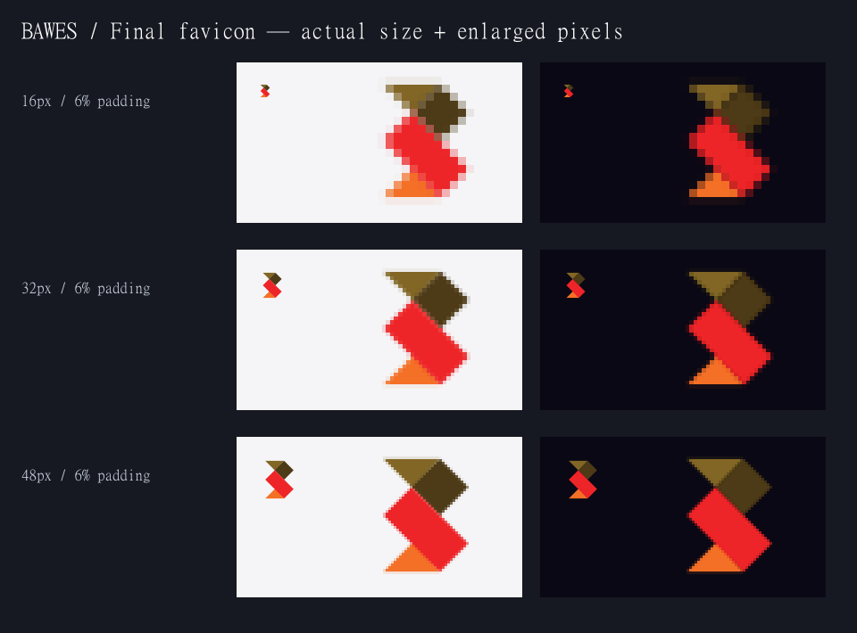
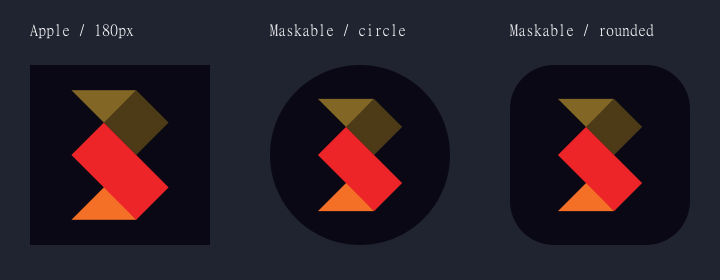
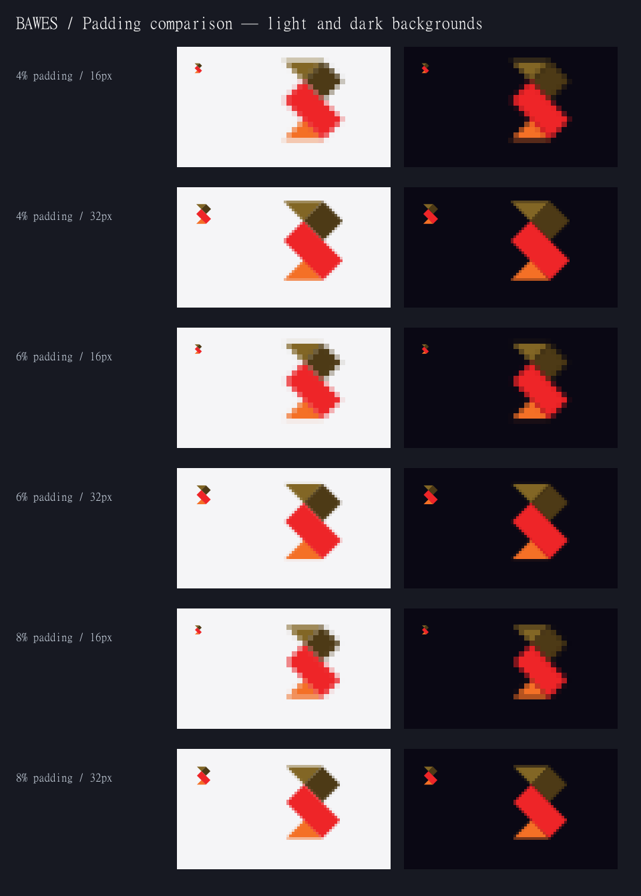

# BAWES favicon assets

The only artwork source is `#emblem` in `public/images/bawes-universe-logo.svg`.
The generator preserves its original four paths, fills, draw order and matrix.
It measures the transformed polygon vertices, then fits their visible bounds
to a square using uniform scaling. The original lockup and legacy PNG are unchanged.

## Generate and verify

```sh
npm ci
npm run icons:generate
npm run build
npm run start
# In a second terminal:
npm run icons:verify -- http://localhost:3000
```

Sharp 0.34.5 is pinned as a development dependency. All output is generated
locally; no image service, tracing, or runtime image generation is involved.
The extractor deliberately rejects unsupported path commands or a changed
palette rather than silently calculating incorrect bounds after a source edit.

## Design choices

- Browser/normal manifest icons: 6% padding on each side of the limiting
  dimension, transparent, geometrically centred, no optical offset.
- Compared 4%, 6%, and 8% at native 16px/32px on light and dark surfaces.
  6% retains a slightly larger silhouette than 8% while keeping approximately
  one pixel of vertical breathing room at 16px. Direct vector rasterisation
  keeps the diagonals antialiased without additional resizing or sharpening.
- All four original colours remain intact. The dark brown naturally has less
  contrast against dark surfaces; it has not been lightened or outlined.
- Apple: independent layout with 14% padding and a fully opaque #0a0814
  background. The operating system supplies the corner treatment.
- Maskable: independent layout fitting every vertex within a centred circle
  of radius 39%, leaving antialiasing clearance inside the required 40% radius.
  Background fills the whole canvas. No corners are baked into this asset.
- ICO: independent 16/32/48 rasterisations encoded as 32-bit DIB frames with
  alpha and legacy AND masks. Verification compares each frame pixel-for-pixel
  with the corresponding preview PNG, including orientation and alpha.

## Next.js integration

`app/icon1.png` and `app/icon2.svg` use Next's numbered file convention.
Testing this repository's Next.js 14.2.35 build with both `icon.png` and
`icon.svg` exposed only the PNG in the head, despite both routes existing.
The numbered names advertise both formats, with the scalable SVG last.
`app/favicon.ico`, `app/apple-icon.png`, and `app/manifest.ts` are also
file-based metadata. There are no manually maintained icon link tags.

The verification script checks `/` and `/work`, follows generated icon URLs
(including query strings), checks manifest icons, inspects dimensions and
transparency, and checks that maskable foreground pixels remain in the circle.

## Review previews

These are generated asset renders, not browser or physical-device screenshots.
Small icons are shown at native size beside nearest-neighbour enlargements;
the enlarged pixels intentionally make raster edges visible.






